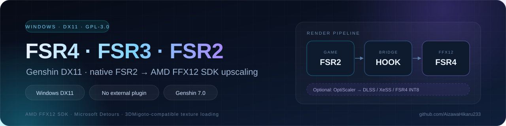
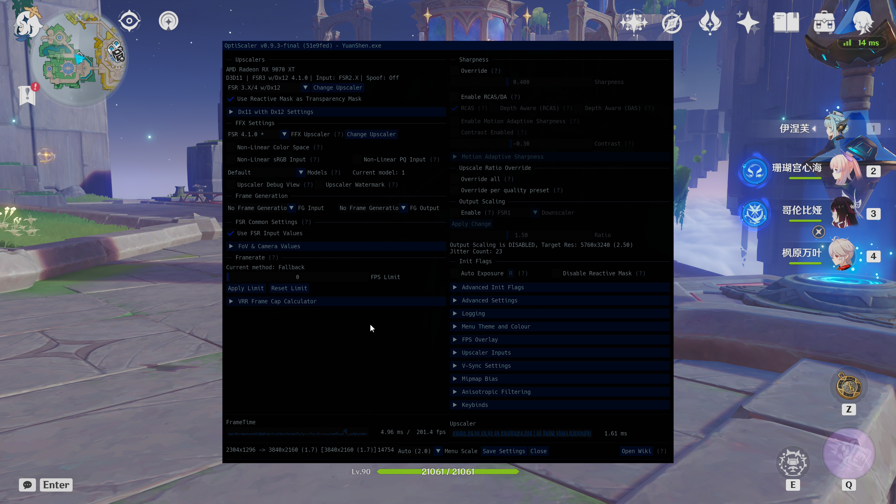
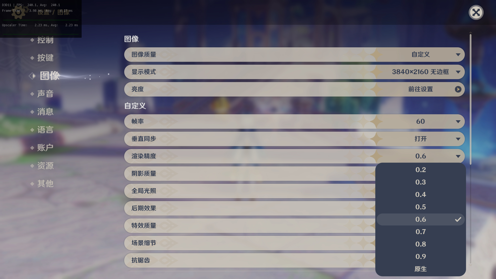
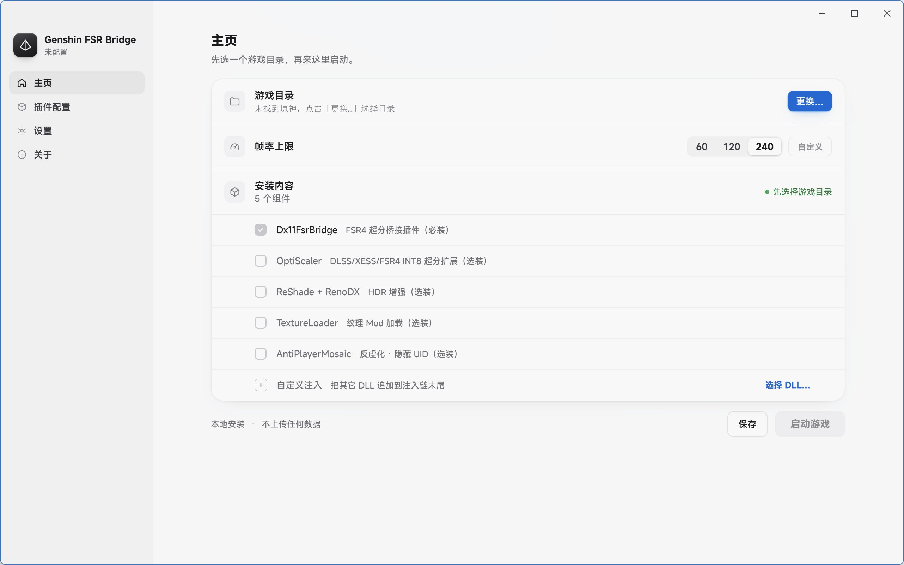
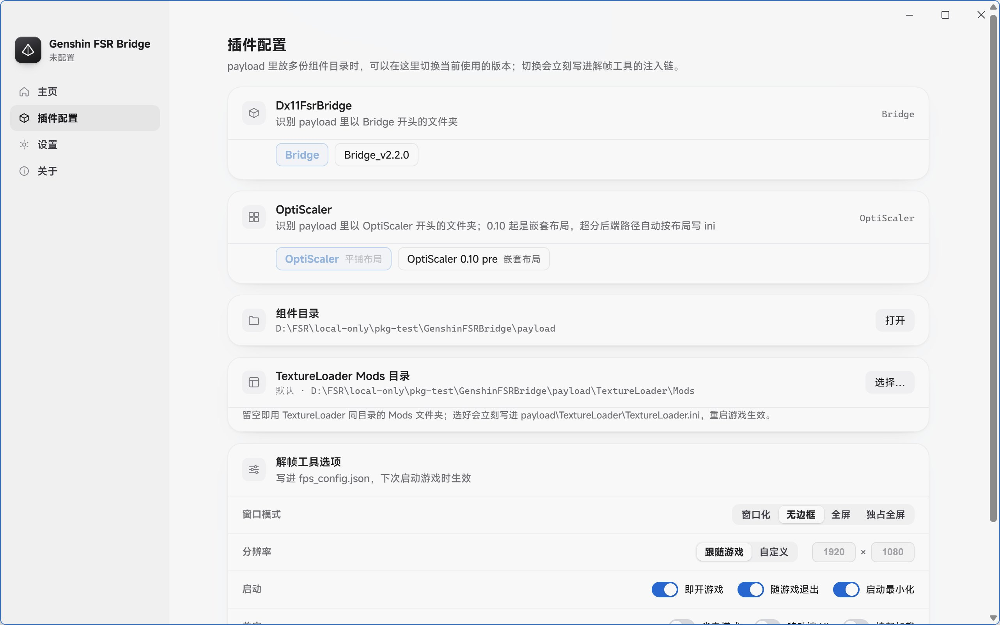
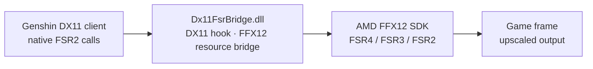

# Genshin FSR Bridge

<p align="center">
  <a href="https://github.com/AizawaHikaru233/genshin_fsr_brigde/releases"></a>
  <a href="Dx11FsrBridge/LICENSE"></a>
  
  
  
  
</p>

<p align="center">
  <a href="README.md">简体中文</a> · <b>English</b>
</p>

<div align="center">
  
</div>

A graphics plugin for the Genshin Impact Windows DX11 client. It independently hooks the game's native FSR2 calls and forwards them to the AMD FFX12 official SDK for upscaling: FSR4/FSR3/FSR2 are provided directly on supported GPUs without any external plugin such as OptiScaler. OptiScaler can additionally be connected to extend the upscaler types (DLSS, XeSS, FSR4 INT8, etc.).

This repository also includes the `AntiPlayerMosaic/` and `TextureLoader/` subprojects: the former is an independently built plugin for fixing Genshin Impact's mosaic effects and hiding the UID; the latter is a 3DMigoto-compatible texture replacement / Mod loader (DDS replacement plus GDDS DirectStorage GPU decompression). See the README and NOTICE in each directory for details.

For the Chinese documentation, see [README.md](README.md).

## Contents

| Overview | Usage | Development & Support |
| :--- | :--- | :--- |
| [Support Scope and Risk Notice](#support-scope-and-risk-notice)<br>[Demo](#demo)<br>[Features](#features)<br>[GPU Support and NVIDIA Caveats](#gpu-support-and-nvidia-caveats) | [Release Packages](#release-packages)<br>[FuFu Launcher Plugin Source and Local Build](#fufu-launcher-plugin-source-and-local-build)<br>[Usage](#usage)<br>[Logs and Issue Feedback](#logs-and-issue-feedback) | [Repository Layout](#repository-layout)<br>[Build](#build)<br>[Third-Party Components](#third-party-components)<br>[License](#license) |

## Support Scope and Risk Notice

- Intended for the Chinese and Global Windows DX11 clients of Genshin Impact.
- Adapted for and verified against Genshin Impact `7.0` and `7.1`. The bridge locates the game's
  internal FSR2 calls and il2cpp methods through **dynamic signature recognition** instead of
  hard-coded RVA / prologue bytes, so it is **not limited to the versions tested so far**: later
  game updates keep working as long as nothing major changes (the FSR2 call path and the related
  internal structures stay stable), with no update from this project required.
- If an update does change those internal structures, the bridge abandons the hook and falls back
  when signatures no longer match (it will not crash), but **upscaling may stop working** until
  this project catches up. See [GPU Support and NVIDIA Caveats](#gpu-support-and-nvidia-caveats).
- Feature and hardware prerequisites: which FSR tier (FSR4/FSR3/FSR2) is actually available
  depends on the **GPU model and driver version** (for example FSR4 requires RDNA4 and a
  matching driver). Every "on supported GPUs" statement below refers to the range listed in
  that section — please confirm your GPU is covered before proceeding.
- This project is not affiliated with, endorsed by, or authorized by `HoYoverse`, `miHoYo`, `Genshin Impact`, or `原神`. All related names and trademarks belong to their respective owners.

> [!WARNING]
> Third-party DLLs, injectors, mods, and graphics plugins may violate game rules and could result in account restrictions or bans. Users must evaluate the risks themselves and accept full responsibility.

## Demo

<table>
  <tr>
    <td width="50%" align="center" valign="top">
      <a href="assets/FSR4激活.jpg"></a>
      <br>
      <sub><b>FSR4 active</b> · overlay reports <code>FSR 4.1.0</code> (AMD Radeon RX 9070 XT)</sub>
    </td>
    <td width="50%" align="center" valign="top">
      <a href="assets/超分档位切换.jpg"></a>
      <br>
      <sub><b>Render scale extended</b> · the quality menu offers <code>0.2–0.999</code></sub>
    </td>
  </tr>
</table>

<table>
  <tr>
    <td width="50%" align="center" valign="top">
      <a href="assets/readme/installer-home.jpg"></a>
      <br>
      <sub><b>Installer · Home</b> · game directory, frame-rate cap, and installed content in one screen</sub>
    </td>
    <td width="50%" align="center" valign="top">
      <a href="assets/readme/installer-plugins.jpg"></a>
      <br>
      <sub><b>Installer · Plugins</b> · component version switch, Mods directory, frame-rate tool options</sub>
    </td>
  </tr>
</table>

<sub>The first two images are in-game captures (3840×2160), the last two are the installer UI (2564×1604); click to open the originals.</sub>

## Release Packages

Packages are assembled directly by the build script, and the default installer is the graphical installer in `Installer/` (details in `Installer/README.md`). The old PowerShell installer scripts (`tools/FpsUnlockInstaller/`) are no longer part of the release package; the source is kept for now, and `-ScriptInstaller` still produces a legacy-flow package. Package feedback and component metadata live in `assets/FpsUnlockPackage/`, and runtime resources and default configuration live in `SharedResources/`. The package-root `README.md` is this file, and the demo images in `assets/readme/` are shipped with it. GitHub release packages do not bundle the NVIDIA DLSS runtime or ReShade binaries: ReShade is fetched from reshade.me only when it is ticked, and with OptiScaler ticked on an RTX card the installer fetches `nvngx_dlss.dll` from NVIDIA Streamline and places it in the OptiScaler component directory (GTX 16 only gets FSR4 INT8, DLSS is not deployed). Local distributions must complete those components on their own.

To generate the GitHub release package, run the following command on Windows:

```powershell
powershell -ExecutionPolicy Bypass -File .\Build-OnlineInstaller.ps1 -Configuration Release -GithubOnly
```

The output is written to `dist\原神解帧FSR插件包_v*.7z`, while the GitHub release directory contains `dist\github-release\GenshinFSRBridge_v*.7z` (the GitHub package is 7z as well). GitHub Actions builds and publishes only this GitHub release package; it does not generate a FuFu package.

## FuFu Launcher Plugin Source and Local Build

`FufuGraphicsPlugin/` contains the FuFu Launcher plugin source, configuration templates, and the marketplace/local-test Lua installer scripts. The repository does not commit a prebuilt FuFu Launcher plugin binary. Before a local build, run `tools/Update-UpstreamComponents.ps1` to refresh the upstream component baseline (OptiScaler is pinned to v0.9.4; DLSS, ReShade, and FPS Unlocker fetch their latest official releases with SHA-256 verification), then run:

```powershell
powershell -ExecutionPolicy Bypass -File .\tools\Update-UpstreamComponents.ps1 -WorkspaceRoot .
powershell -ExecutionPolicy Bypass -File .\Build-OnlineInstaller.ps1 -Configuration Release
```

`-FetchUpstream` can be passed to the build script to refresh upstream components before packaging. The FuFu Launcher plugin package is written only to local `dist\FSR-Bridge-Plugin.v*.zip`; it is not included in GitHub Actions or GitHub Releases.

## Features

The core path of the bridge is to intercept the game's native FSR2 calls and forward them to the FFX12 SDK:



| Module | Capability | Notes |
| :---: | --- | --- |
| 🎯 | **Native FSR forwarding** | Intercepts DX11 device and context activity to obtain the timing of Genshin Impact's FSR2 calls. |
| 🧩 | **FFX12 resource bridge** | Prepares color, depth, motion-vector, jitter, and history resources for the FFX12 SDK and forwards the upscaling dispatch. |
| ⚡ | **Automatic tier matching** | Auto-matches the FSR series by GPU capability (FSR4/FSR3/FSR2); upscaling works on supported GPUs without external plugins. |
| 🎚 | **Extended render scale** | Extends the in-game render-scale menu to `0.2–0.999`. |
| 📝 | **Runtime logs** | Writes runtime logs to `Dx11FsrBridge.log` beside the DLL by default for load and hook diagnostics. |
| 🖼 | **TextureLoader** (texture/Mod loader) | 3DMigoto-compatible `[TextureOverride]` Mod loading (DDS replacement + GDDS DirectStorage GPU decompression), loading from the package `Mods` directory by default. **Currently it supports pure texture mods only — model mods are not supported** (see "[TextureLoader Scope](#textureloader-scope)" below). **On NVIDIA GPUs this component is not recommended** (replaced texture mods will very likely fail to load; it is not completely unusable, and it can still be enabled manually) — see "[GPU Support and NVIDIA Caveats](#gpu-support-and-nvidia-caveats)" below. |

## GPU Support and NVIDIA Caveats

| Component | AMD | NVIDIA | Intel |
| --- | --- | --- | --- |
| FSR Bridge (FSR4/FSR3/FSR2) | ✅ | ✅ (incl. DLSS/XeSS/FSR4 INT8) | ✅ (XeSS) |
| OptiScaler (DLSS/XeSS/FSR4 INT8) | ✅ | ✅ | ✅ |
| Anti-Mosaic / Hide UID, ReShade + RenoDX | ✅ | ✅ | ✅ |
| **OptiScaler + ReShade enabled together** | ✅ | ⚠️ **May be unstable** | ✅ |
| **TextureLoader (texture/Mod loader)** | ✅ Supported | ⚠️ **Not recommended (texture mods may fail to load; can be enabled manually)** | ⚠️ Untested |

<sub>✅ Supported · ⚠️ Conditional or not recommended</sub>

### Enabling OptiScaler and ReShade together may be unstable on NVIDIA

> [!WARNING]
> **Using OptiScaler alone, or ReShade alone, is fine; enabling both at the same time may misbehave or be unstable on NVIDIA.**

That depends on how the two interact with NVIDIA drivers and on their load order, not on this project's code — this project only loads them in the default order.

If you run into trouble:

- **Isolate first**: temporarily enable only one of the two and check whether the problem disappears;
- Report it to the [OptiScaler upstream repository](https://github.com/optiscaler/OptiScaler) or this project's [Issues](https://github.com/AizawaHikaru233/genshin_fsr_brigde/issues), attaching `OptiScaler.log` and `ReShade.log` from the game directory;
- If it is still unstable, **keep only one of the two**: FSR Bridge's own FSR4/FSR3/FSR2 depends on neither — enable OptiScaler for DLSS/XeSS/FSR4 INT8, enable ReShade for HDR.

### TextureLoader is not recommended on NVIDIA (texture Mods may fail to load)

**TextureLoader is not recommended on NVIDIA cards, but it is not blocked: you can still enable it manually.**

**On NVIDIA cards there is a very high chance that replaced texture mods fail to load — it is not completely unusable, but it is not recommended; sometimes it works fine, and no specific condition has been identified.**

<details>
<summary><b>Why can replaced texture Mods fail to load on NVIDIA? (investigation log)</b></summary>

The author does not own an NVIDIA card and could only rely on repeated testing by community members, so the root cause was never located. The following were ruled out: the Mod texture files themselves (all 3139 DDS files verified as valid BC3), format and SRV view handling (every logged field matches the AMD machine exactly, `hr=0`), hash matching and ini overrides, threading (identical thread topology on both machines), cross-machine file differences (byte-identical FNV fingerprints), alpha-channel content, and reuse of the initial-data buffer by subsequent loads (that defect was fixed, yet the NVIDIA output is still wrong). The only factor that cannot be reproduced locally is **the NVIDIA driver's texture creation / upload timing**.

</details>

Every distribution channel therefore behaves as follows:

- **TextureLoader's configuration and installation entries are always visible and can be enabled manually**: the **FuFu Launcher plugin package** and the **GitHub release package** no longer hide or force-disable this component per GPU vendor. On NVIDIA cards it only prints a "not recommended" note when you select/switch it on.
- **On NVIDIA cards no automatic path ever enables it**: on NVIDIA, "install all modules at once" excludes TextureLoader (you must select module 5 by hand to get it); restoring factory settings, restoring/applying configuration templates, and the defaults used when the configuration is missing or corrupt never turn it on either — it stays **off** unless you enabled it yourself, and these paths will not switch off an enablement you made. It is loaded only when you explicitly enable it (manually selecting module 5 during installation, switching it on in the plugin configuration screen, or passing `-EnableTextureLoader` on the command line).
- **NVIDIA users who want this fixed properly** are welcome to fork the repository, fix it, and submit a Pull Request.
- **You can also sponsor an NVIDIA GPU for the author**, who will then attempt to locate and fix the issue.

> [!NOTE]
> AMD users are unaffected: interactive installation still asks whether to enable it (default No), and it can be toggled at any time from the plugin configuration screen. On AMD, "Install all modules" includes it automatically (on NVIDIA cards you must select module 5 by hand).

### TextureLoader Scope

**TextureLoader currently supports only "pure texture" mods — model mods are not supported.**

| Type | Supported | Notes |
| --- | --- | --- |
| **Pure texture replacement** (DDS / GDDS) | ✅ Yes | Matched via 3DMigoto-compatible `hash=`, replaces texture pixel content |
| Model / mesh replacement (mesh, `.buf`, `.ib`) | ❌ Not yet | Requires hooking vertex/index buffers and draw calls; this component does not |
| Skeleton / animation modification | ❌ Not yet | Same as above |
| Material / shader replacement | ❌ Not yet | Requires hooking shader compilation or material constants |
| `[CommandList*]` / `[Present]` draw-stage commands | ❌ Not yet | Draw-command replay is not implemented |

The hashing algorithm is a verbatim port of 3DMigoto, so **pre-generated `hash=` values from mod authors can be reused as-is**; however, the **execution capability is far smaller than 3DMigoto's** — the latter is a complete draw-interception and command-replay framework, whereas this component implements only the single path of "replace pixels when a texture is created."

> [!NOTE]
> If a mod contains both textures and models, **the texture part takes effect and the model part does not** — it will look like "the texture changed but the shape did not". That is not a defect; it is the current scope.
> See [`TextureLoader/README.md`](TextureLoader/README.md#支持范围) for the full description.

## Repository Layout

| Directory | Description |
| --- | --- |
| Repository root | FSR Bridge source, configuration, and build files. |
| `AntiPlayerMosaic/` | Anti-aliasing blur removal, UID hiding, and underwater mosaic fix plugin. |
| `FufuGraphicsPlugin/` | FuFu Launcher bootstrap, configuration files, and install scripts. |
| `TextureLoader/` | 3DMigoto-compatible texture replacement / Mod loader (DDS + GDDS, **pure texture mods only**). |
| `Installer/` | Graphical installer (Tauri 2 + Rust + WebView2): manages the injection chain, component versions, component logs, and self-update of the plugin package. |
| `SharedResources/` | Runtime resources and component archives shipped with the package. The Genshin-specific RenoDX HDR shader add-on and its redistribution authorization record are archived under `SharedResources/ReShade/runtime/reshade-shaders/`. |

## Usage

> [!WARNING]
> This package is **Windows-only**, and there is no Linux compatibility: the graphical installer depends on
> the WebView2 runtime, so it cannot run under Wine / Proton (it closes immediately when launched).
> Linux users should follow **Linux install / Windows manual install** below.

### Windows: graphical installer

1. Download the **latest** package from [Releases](https://github.com/AizawaHikaru233/genshin_fsr_brigde/releases)
   and extract it to a directory **without Chinese characters or illegal characters**
   (`GenshinFSRBridgeInstaller.exe` must sit next to `payload\`).
2. Double-click `GenshinFSRBridgeInstaller.exe`. No administrator rights are needed, and nothing is written to system directories.
3. Click **Change…** to pick the Genshin Impact install directory; the installer also scans the registry and common paths by itself.
4. Tick the **components to enable** and click **Save** — this writes the absolute path of every selected component into the
   injection chain (`DllList`) of `payload\FpsUnlocker\fps_config.json`, so no DLL is ever placed in the game directory.

   - **Replacing the upscaler only** → at least **Dx11FsrBridge** (required, ticked by default)
   - **DLSS or XeSS needed** → also tick **OptiScaler**
   - **HDR enhancement needed** → tick **ReShade + RenoDX** (on NVIDIA cards the installer warns about running it together with OptiScaler)

5. Click **Launch game**. The installer starts the frame-rate tool in place under `payload\FpsUnlocker\`, and that tool injects
   and launches the game. Afterwards just use the desktop shortcut (optional during install) or your own launcher.

> [!IMPORTANT]
> **In-game settings (required)**: enable `FSR2` anti-aliasing and set the render scale **below `1`**.

GitHub release packages include FPS Unlocker and OptiScaler; when a component is missing, the Plugins page offers a
**Download** button that fetches it from its official upstream on the spot (ReShade from reshade.me, the rest from this
repository Releases), instead of re-downloading the whole package. Local distributions must complete the required
components on their own.

The old PowerShell installer scripts (`一键配置.bat` / `GenshinFSRBridgeTools.bat`) are no longer shipped; to build the
legacy flow yourself, pass `-ScriptInstaller` to `Build-OnlineInstaller.ps1`.

### Linux install / Windows manual install

1. Download the **latest** package from [Releases](https://github.com/AizawaHikaru233/genshin_fsr_brigde/releases)
   and extract it to a directory **without Chinese characters or illegal characters**.
2. Find a launcher that can **inject DLLs into Genshin Impact under Linux + Wine/Proton**.
   (On Windows, using another launcher with DLL-injection support follows the same procedure.)
3. Install the components:

   - **Replacing the upscaler only** → install at least **Bridge**
   - **DLSS or XeSS needed** → also install **OptiScaler**

**Injection order**: **Bridge must load before OptiScaler**. Other plugins have no strict requirement.

When injecting OptiScaler manually, either approach is recommended:

- Point **`OptiDllPath`** in the **`[Libraries]`** section of `OptiScaler.ini` at the **directory holding the upscaling
  components** — that is, the directory containing `amd_fidelityfx_upscaler_dx12.dll`. It is **not necessarily** the
  directory containing `OptiScaler.dll`:

  | OptiScaler version | Layout | What to set `OptiDllPath` to |
  |---|---|---|
  | 0.9.x | Flat: components sit next to `OptiScaler.dll` | the directory containing `OptiScaler.dll` |
  | 0.10 nightly | Nested: components live in an `OptiScaler\` subdirectory | that `OptiScaler\` subdirectory |
- Copy the **entire file set** into the game's main-executable directory the way OptiScaler officially recommends, then specify the DLL to inject.

> [!IMPORTANT]
> Note that `OptiScaler.dll` and `OptiScaler.ini` sit at the **root level in both layouts** (OptiScaler reads its
> ini from its own directory), so do **not** simply use the ini's directory as `OptiDllPath`. Getting it wrong makes
> OptiScaler inject successfully yet find no upscaling backend at all ("takes over but cannot enable"), and it may
> also hang in DETACH on exit, leaving the process behind.

The main executable differs by release:

| Release | Main executable |
|---|---|
| China (CN) | `YuanShen.exe` |
| Global | `GenshinImpact.exe` |

### Components and paths

`Dx11FsrBridge.dll` independently hooks Genshin Impact's FSR2 calls and forwards them to the AMD FFX12 SDK, providing
FSR4/FSR3/FSR2 upscaling directly on supported GPUs **without any external plugin**.
[OptiScaler](https://github.com/optiscaler/OptiScaler) can optionally be connected to extend the upscaler types
(DLSS, XeSS, FSR4 INT8, etc.). The package configures component loading in the default order, so manual ordering is
normally not required; `AntiPlayerMosaic.dll` is an optional anti-mosaic / UID-hiding plugin.

When OptiScaler and ReShade are used, their runtime configurations are located in their respective component
directories. OptiScaler DLL and log paths, as well as ReShade shader, texture, preset, and screenshot paths, use
**relative paths**. This prevents third-party configuration-saving logic from incorrectly transcoding installation
paths that contain Chinese characters. Only the game-directory `[INSTALL] BasePath`, which locates the external
ReShade directory, must use a dynamically generated absolute path when installed across directories or drives.

## Build

Visual Studio with the Desktop development with C++ workload, the Windows SDK, and CMake 3.20 or newer (Ninja generator) are required. The release configuration requires the repository's `Dx11FsrBridge\third_party` directory, which contains the FFX12 ffx-api headers and the Microsoft Detours build dependency.

A Rust toolchain (`cargo`) is also required to build the graphical installer: run `Installer\app\build-app.ps1` once to produce `Installer\app\GenshinFSRBridgeInstaller.exe`; the packaging script takes that file directly and fails with a hint when it is missing.

First refresh the upstream component baseline (only needed when component versions change; the script pins OptiScaler to v0.9.4 and fetches the latest official DLSS, ReShade, and FPS Unlocker releases):

```powershell
powershell -ExecutionPolicy Bypass -File .\tools\Update-UpstreamComponents.ps1 -WorkspaceRoot .
```

Local builds must supply the required components themselves.

Then build all release packages:

```powershell
powershell -ExecutionPolicy Bypass -File .\Build-OnlineInstaller.ps1 -Configuration Release
```

`-FetchUpstream` combines both steps. The four first-party DLLs (Bridge / AntiPlayerMosaic / TextureLoader / FufuGraphicsPlugin) are compiled automatically by the build script with the Ninja generator; no manual cmake invocation is needed.

## Logs and Issue Feedback

Bridge and the anti-mosaic component retain error logs by default (when OptiScaler/ReShade are connected, they also retain their own logs). Each new run overwrites the previous run's logs.
If the game fails to start, FSR cannot be activated, switching upscalers causes a crash, or another issue occurs, do not launch the game again after reproducing it. Provide the following files and information:

| # | File / Information | When it applies |
| :---: | --- | --- |
| 1 | `payload/Bridge/Dx11FsrBridge.log` | **Required** |
| 2 | `payload/OptiScaler/OptiScaler.log` and `payload/OptiScaler/OptiScaler.ini` | When using OptiScaler |
| 3 | `payload/ReShade/ReShade.log` | For ReShade-related issues |
| 4 | `payload/AntiPlayerMosaic/AntiPlayerMosaic.log` | For anti-mosaic, UID, or underwater mosaic issues |
| 5 | `payload/TextureLoader/TextureLoader.log` | For texture replacement / Mod loading issues |
| 6 | `FSR-Bridge-Plugin.log` from the FuFu plugin directory | When using the FuFu Launcher plugin |
| 7 | GPU model, game version, the stage at which the issue occurs, and the selected upscaling mode | — |

When further diagnostics are needed, temporarily change `LogLevel` under `Log` in `OptiScaler.ini` (when OptiScaler is used) to `1 (Debug)` or `0 (Trace)`. Restore the release setting after diagnostics to avoid additional overhead.

> [!CAUTION]
> Do not submit game account details, login information, or screenshots containing personal information to a public Issue.

## Third-Party Components

- FFX12 ffx-api headers and Microsoft Detours are build dependencies only; their original licenses and notices are retained.
- OptiScaler is an independent project: <https://github.com/optiscaler/OptiScaler>.
- Local distributions must complete the required components on their own and comply with each component's licensing terms.
- This project does not include NVIDIA DLSS or AMD FSR SDK runtime binaries.

## License

This project is licensed under [GPL-3.0-or-later](Dx11FsrBridge/LICENSE). You may use, modify, and redistribute the code; when distributing a modified version, you must provide the corresponding complete source code and license it under GPL-3.0-or-later.

<div align="center">
  <sub>Genshin FSR Bridge · GPL-3.0-or-later · <a href="https://github.com/AizawaHikaru233/genshin_fsr_brigde/releases">Releases</a> · <a href="https://github.com/AizawaHikaru233/genshin_fsr_brigde/issues">Issues</a></sub>
</div>
